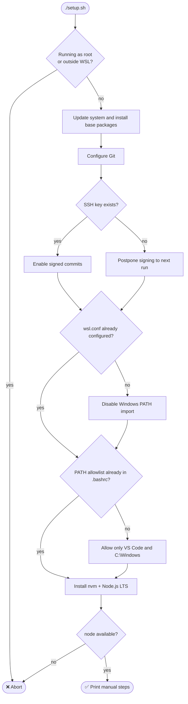

<div align="center">

# 🛡️ secure-wsl-devkit

**Automated, idempotent and security-first setup for a WSL 2 development environment.**

One script. Same environment on every machine. No leaks between Windows and Linux.

[](https://github.com/ADSLustosa/secure-wsl-devkit/actions/workflows/shellcheck.yml)


[](LICENSE)

🌐 **English** · [Português](README.pt-BR.md)

</div>

---

## 📌 Why this exists

Setting up WSL 2 by hand on more than one computer leads to three silent problems:

| Problem | Real impact |
|---|---|
| **Windows PATH leaks into Linux** | By default, WSL imports every Windows directory into the Linux `PATH`. Commands like `npm` may silently run the **Windows** binary inside Linux, causing hard-to-debug errors and slower shell lookups. |
| **Environments drift apart** | Manual steps are forgotten or done differently on each machine, so code that works on the laptop breaks on the desktop. |
| **Unverifiable identity** | Anyone can commit using your name and e-mail. Without signed commits, there is no proof that a commit came from you. |

`secure-wsl-devkit` solves all three with a single script that can be safely run as many times as needed.

## ✨ Highlights

- 🔁 **Idempotent** — running it twice produces the same result as running it once. Nothing is duplicated.
- 🔐 **Least privilege PATH** — instead of importing dozens of Windows directories, only **2** are explicitly allowed.
- ✍️ **Signed commits** — Git is configured to sign every commit with SSH, showing the **Verified** badge on GitHub.
- 🛑 **Fail fast** — `set -euo pipefail` stops execution on the first unexpected error.
- 🧪 **Explicit verification** — the script checks results instead of trusting the absence of errors.
- 🤖 **Continuous Integration** — every pull request is statically analyzed by ShellCheck.

## ⚙️ How it works



Each **diamond** is an idempotency check: the step only runs when the configuration is missing.

## 🧰 What it configures

| Step | What it does | Why |
|---|---|---|
| Environment check | Blocks execution as `root` and outside WSL | Prevents configuring the wrong user or the wrong system |
| Base packages | `build-essential`, `curl`, `unzip`, `keychain`, `shellcheck` | Compilers for native Node modules, SSH agent and shell linting |
| Git | Identity, `main` as default branch, `pull.rebase`, `autocrlf input`, `fetch.prune` | Linear history, Linux line endings and a clean list of branches |
| Commit signing | `gpg.format ssh`, signing key and `allowed_signers` | Cryptographic proof of authorship |
| `wsl.conf` | `appendWindowsPath = false` | Stops the Windows PATH from leaking into Linux |
| PATH allowlist | Only VS Code and `C:\Windows` | Keeps `code .` and `explorer.exe .` working, nothing else |
| Node.js | `nvm` + latest LTS | Per-project Node versions without `sudo` |

## 🔐 Security decisions

| Decision | Reasoning |
|---|---|
| **SSH key generation is manual, on purpose** | Each machine gets its own key. If one device is lost, only that key is revoked. Private keys are never copied or automated. |
| **GitHub host fingerprint is verified manually** | Accepting an unknown fingerprint blindly opens the door to man-in-the-middle attacks. |
| **`noreply` e-mail in commits** | Commits stay linked to the GitHub account without exposing a personal e-mail to scrapers. |
| **Pinned nvm installer version** | The installer URL points to a fixed version, not to "latest", which could change without notice. |
| **`curl -fsSL`** | `-f` makes HTTP errors fail, so an error page is never piped into `bash`. |
| **Namespaced variables (`DEVKIT_`)** | Avoids collisions with variables from sourced scripts, such as `nvm.sh`. |
| **Read-only CI token** | The workflow declares `permissions: contents: read`, following the principle of least privilege. |
| **No secrets in the repository** | Passwords, passphrases and tokens live in a password manager, never in code. |

## 🚀 Quick start

### Requirements

- Windows 10/11 with **WSL 2**
- An **Ubuntu** distribution (tested on 26.04 LTS)
- **VS Code** installed on Windows

### 1. Clone and run

On a brand new machine there is no SSH key yet, so clone over **HTTPS**:

```bash
mkdir -p ~/projetos && cd ~/projetos
git clone https://github.com/ADSLustosa/secure-wsl-devkit.git
cd secure-wsl-devkit
./setup.sh
```

> ⚠️ Do not run it with `sudo`. The script asks for your password only when it needs it.

### 2. Manual steps (intentional)

```bash
# Generate a key unique to this machine
ssh-keygen -t ed25519 -C "$(hostname)-wsl" -f ~/.ssh/id_ed25519

# Show the public key to register on GitHub
cat ~/.ssh/id_ed25519.pub
```

1. On GitHub, go to **Settings → SSH and GPG keys** and add the key **twice**: as an *Authentication Key* and as a *Signing Key*.
2. Run `ssh -T git@github.com` and compare the fingerprint with the [official GitHub fingerprints](https://docs.github.com/en/authentication/keeping-your-account-and-data-secure/githubs-ssh-key-fingerprints). You can paste the official value as the answer and SSH compares it for you.
3. Run `./setup.sh` again to enable commit signing.
4. In **PowerShell**, restart only this distribution to apply `wsl.conf`:

```powershell
wsl --terminate Ubuntu-26.04
```

## ✅ Verifying the result

```bash
# Only VS Code and C:\Windows should come from /mnt/c
echo "$PATH" | tr ':' '\n' | grep '^/mnt/'

# node and npm must come from ~/.nvm, never from /mnt/c
command -v node npm

# Idempotency: both must print 1, even after several runs
grep -c "appendWindowsPath" /etc/wsl.conf
grep -c "Caminhos do Windows liberados" ~/.bashrc

# Signature check of the latest commit in any repository
git log --show-signature -1
```

## 📁 Project structure

```
secure-wsl-devkit/
├── .github/
│   └── workflows/
│       └── shellcheck.yml   # CI: static analysis on every push and pull request
├── setup.sh                 # Idempotent setup script
├── LICENSE
├── README.md                # English
└── README.pt-BR.md          # Português
```

## 🗺️ Roadmap

- ✅ Idempotent setup script
- ✅ Signed commits via SSH
- ✅ Windows PATH allowlist
- ✅ ShellCheck in CI
- 🔜 Validate the script on a fresh distribution in CI
- 🔜 Container runtime setup (Docker Desktop WSL integration)
- 🔜 Secret scanning before every commit with Gitleaks + pre-commit
- 🔜 Pin GitHub Actions by commit SHA, kept up to date by Dependabot

## 📄 License

Distributed under the MIT License. See [LICENSE](LICENSE) for details.

---

<div align="center">

Built by **[ADSLustosa](https://github.com/ADSLustosa)** · Full-stack developer focused on security and data protection (LGPD)

</div>
