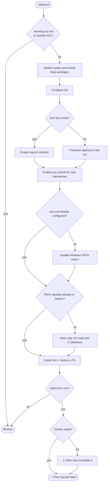

<a name="readme-top"></a>

<picture>
  <source media="(prefers-color-scheme: dark)" srcset="assets/banner-en-dark.svg">
  <source media="(prefers-color-scheme: light)" srcset="assets/banner-en-light.svg">
  
</picture>

<div align="center">

[](https://github.com/ADSLustosa/secure-wsl-devkit/actions/workflows/shellcheck.yml)
[](https://github.com/ADSLustosa/secure-wsl-devkit/actions/workflows/fresh-install.yml)
[](https://github.com/ADSLustosa/secure-wsl-devkit/actions/workflows/gitleaks.yml)


[](LICENSE)

🌐 **English** · [Português](README.pt-BR.md)

**[Why](#-why-this-exists)** · **[Demo](#-see-it-in-action)** · **[Impact](#-measured-impact)** · **[How it works](#-how-it-works)** · **[Security](#-security-decisions)** · **[Quick start](#-quick-start)** · **[Roadmap](#-roadmap)**

</div>

---

## 📌 Why this exists

Setting up WSL 2 by hand on more than one computer leads to three silent problems:

| Problem | Real impact |
|---|---|
| **Windows PATH leaks into Linux** | By default, WSL imports every Windows directory into the Linux `PATH`. Commands like `npm` may silently run the **Windows** binary inside Linux, causing hard-to-debug errors and slower shell lookups. |
| **Environments drift apart** | Manual steps are forgotten or done differently on each machine, so code that works on the laptop breaks on the desktop. |
| **Unverifiable identity** | Anyone can commit using your name and e-mail. Without signed commits, there is no proof that a commit came from you. |

`secure-wsl-devkit` solves all three with a single script that can be safely run as many times as needed.

## 🎬 See it in action



<sub>A second run on an already configured machine: each step detects the existing configuration and nothing is duplicated. The script output is in Portuguese.</sub>

## 📊 Measured impact

<picture>
  <source media="(prefers-color-scheme: dark)" srcset="assets/impact-en-dark.svg">
  <source media="(prefers-color-scheme: light)" srcset="assets/impact-en-light.svg">
  
</picture>

> [!NOTE]
> These numbers come from the read-only diagnostic run on the author's machine before and after `setup.sh`, not from estimates.

## ✨ Highlights

<table>
  <tr>
    <td width="33%" valign="top">🔁 <b>Idempotent</b><br><sub>Running it twice produces the same result as running it once. Nothing is duplicated.</sub></td>
    <td width="33%" valign="top">🔐 <b>Least privilege PATH</b><br><sub>Instead of importing dozens of Windows directories, only <b>2</b> are explicitly allowed.</sub></td>
    <td width="33%" valign="top">✍️ <b>Signed commits</b><br><sub>Every commit is signed with SSH and shows the <b>Verified</b> badge on GitHub.</sub></td>
  </tr>
  <tr>
    <td width="33%" valign="top">🛑 <b>Fail fast</b><br><sub><code>set -euo pipefail</code> stops execution on the first unexpected error.</sub></td>
    <td width="33%" valign="top">🧪 <b>Explicit verification</b><br><sub>The script checks results instead of trusting the absence of errors.</sub></td>
    <td width="33%" valign="top">🤖 <b>Protected main branch</b><br><sub>Changes only land through pull requests with signed commits, a green ShellCheck run and no secrets found by Gitleaks.</sub></td>
  </tr>
</table>

## 🔄 How it works

<picture>
  <source media="(prefers-color-scheme: dark)" srcset="assets/flow-en-dark.svg">
  <source media="(prefers-color-scheme: light)" srcset="assets/flow-en-light.svg">
  
</picture>

### 🧩 Decision flow



Each **diamond** is an idempotency check: the step only runs when the configuration is missing.

<details>
<summary><b>🧰 What it configures</b> (click to expand)</summary>
<br>

| Step | What it does | Why |
|---|---|---|
| Environment check | Blocks execution as `root` and outside WSL | Prevents configuring the wrong user or the wrong system |
| Base packages | `build-essential`, `curl`, `unzip`, `keychain`, `shellcheck` | Compilers for native Node modules, SSH agent and shell linting |
| Git | Identity, `main` as default branch, `pull.rebase`, `autocrlf input`, `fetch.prune` | Linear history, Linux line endings and a clean list of branches |
| pre-commit | `init.templateDir` with the pre-commit hook | Every new clone with a `.pre-commit-config.yaml` gets the hooks automatically |
| Commit signing | `gpg.format ssh`, signing key and `allowed_signers` | Cryptographic proof of authorship |
| `wsl.conf` | `appendWindowsPath = false` | Stops the Windows PATH from leaking into Linux |
| PATH allowlist | Only VS Code and `C:\Windows` | Keeps `code .` and `explorer.exe .` working, nothing else |
| Node.js | `nvm` + latest LTS | Per-project Node versions without `sudo` |
| Docker | Checks the Docker Desktop WSL integration | Warns with the exact fix instead of failing the whole setup |

</details>

## 🔐 Security decisions

<picture>
  <source media="(prefers-color-scheme: dark)" srcset="assets/gates-en-dark.svg">
  <source media="(prefers-color-scheme: light)" srcset="assets/gates-en-light.svg">
  
</picture>

| Decision | Reasoning |
|---|---|
| **SSH key generation is manual, on purpose** | Each machine gets its own key. If one device is lost, only that key is revoked. Private keys are never copied or automated. |
| **GitHub host fingerprint is verified manually** | Accepting an unknown fingerprint blindly opens the door to man-in-the-middle attacks. |
| **`noreply` e-mail in commits** | Commits stay linked to the GitHub account without exposing a personal e-mail to scrapers. |
| **Pinned nvm installer version** | The installer URL points to a fixed version, not to "latest", which could change without notice. |
| **`curl -fsSL`** | `-f` makes HTTP errors fail, so an error page is never piped into `bash`. |
| **Namespaced variables (`DEVKIT_`)** | Avoids collisions with variables from sourced scripts, such as `nvm.sh`. |
| **Read-only CI token** | The workflow declares `permissions: contents: read`, following the principle of least privilege. |
| **Safety guards are tested** | CI proves the script refuses to run as `root` or outside WSL, not only that it works. |
| **Protected `main` branch** | A ruleset blocks direct pushes, force pushes and unsigned commits, and requires a green CI run before merging. |
| **Secret scanning in three layers** | A Gitleaks pre-commit hook blocks the commit, a CI job scans the whole history, and GitHub push protection is the last barrier. Findings are always redacted. |
| **Tools pinned to immutable references** | GitHub Actions and the Gitleaks hook are pinned by commit SHA, and the CI binary is verified against a checksum stored in this repository. A check rejects any unpinned action. |
| **Dependabot with a cooldown** | Pinned actions still get updates through weekly pull requests, which wait 7 days after a release and pass the same checks. |
| **Docker daemon exposure check** | Warns when `DOCKER_HOST` points to TCP without TLS: control of Docker is equivalent to root access. |
| **No secrets in the repository** | Passwords, passphrases and tokens live in a password manager, never in code. |

## 🚀 Quick start

**Requirements:** Windows 10/11 with **WSL 2**, an **Ubuntu** distribution (tested on 26.04 LTS) and **VS Code** installed on Windows.

### 1. Clone and run

On a brand new machine there is no SSH key yet, so clone over **HTTPS**:

```bash
mkdir -p ~/projetos && cd ~/projetos
git clone https://github.com/ADSLustosa/secure-wsl-devkit.git
cd secure-wsl-devkit
./setup.sh
```

> [!WARNING]
> Do not run it with `sudo`. The script asks for your password only when it needs it, and running it as `root` would configure the wrong user.

### 2. Manual steps (intentional)

> [!IMPORTANT]
> These steps are manual **by design**: private keys and trust decisions should never be automated.

```bash
# Generate a key unique to this machine
ssh-keygen -t ed25519 -C "$(hostname)-wsl" -f ~/.ssh/id_ed25519

# Show the public key to register on GitHub
cat ~/.ssh/id_ed25519.pub
```

1. On GitHub, go to **Settings → SSH and GPG keys** and add the key **twice**: as an *Authentication Key* and as a *Signing Key*.
2. Run `ssh -T git@github.com` and compare the fingerprint with the [official GitHub fingerprints](https://docs.github.com/en/authentication/keeping-your-account-and-data-secure/githubs-ssh-key-fingerprints).
3. Run `./setup.sh` again to enable commit signing.
4. In **PowerShell**, restart only this distribution to apply `wsl.conf`: `wsl --terminate Ubuntu-26.04`
5. This repository was cloned before the setup, so enable its hooks once: `pre-commit install`

> [!TIP]
> When SSH asks whether to trust the host, paste the official fingerprint as the answer instead of typing `yes`. SSH compares the values for you and removes human error.

<details>
<summary><b>✅ Verifying the result</b> (click to expand)</summary>
<br>

```bash
# Only VS Code and C:\Windows should come from /mnt/c
echo "$PATH" | tr ':' '\n' | grep '^/mnt/'

# node and npm must come from ~/.nvm, never from /mnt/c
command -v node npm

# Idempotency: both must print 1, even after several runs
grep -c "appendWindowsPath" /etc/wsl.conf
grep -c "Caminhos do Windows liberados" ~/.bashrc

# Signature check of the latest commit in any repository
git log --show-signature -1
```

</details>

<details>
<summary><b>🎨 About the visuals</b> (click to expand)</summary>
<br>

Every image in this README is an animated SVG **generated from code** by [`assets/generate.py`](assets/generate.py), using only the Python standard library:

- **No external services or trackers:** nothing is loaded from third-party servers.
- **Light and dark themes:** `<picture>` serves the version that matches the reader's GitHub theme.
- **Accessible:** each SVG has a `<title>` and `<desc>` for screen readers, and readers with *reduced motion* enabled see the complete, static final frame.

To regenerate them after a change:

```bash
python3 assets/generate.py
```

</details>

## 📁 Project structure

```
secure-wsl-devkit/
├── .github/
│   ├── dependabot.yml       # Weekly updates of the pinned actions, with a 7-day cooldown
│   └── workflows/
│       ├── fresh-install.yml # CI: runs setup.sh twice on a fresh Ubuntu
│       ├── gitleaks.yml     # CI: scans the whole history for secrets
│       └── shellcheck.yml   # CI: ShellCheck and pinned-actions check
├── assets/
│   ├── generate.py          # Generates every README visual (stdlib only)
│   └── *.svg                # Banner, terminal, impact, flow, security gates and roadmap
├── .pre-commit-config.yaml  # Gitleaks, ShellCheck and pinned actions before every commit
├── setup.sh                 # Idempotent setup script
├── tests/
│   ├── check-pinned-actions.sh # Rejects any action not pinned by commit SHA
│   └── fresh-install.sh     # Integration test with a simulated WSL
├── LICENSE
├── README.md                # English
└── README.pt-BR.md          # Português
```

## 🧭 Roadmap

<picture>
  <source media="(prefers-color-scheme: dark)" srcset="assets/roadmap-en-dark.svg">
  <source media="(prefers-color-scheme: light)" srcset="assets/roadmap-en-light.svg">
  
</picture>

<details>
<summary><b>📝 Text version</b></summary>
<br>

- ✅ Idempotent setup script
- ✅ Signed commits via SSH
- ✅ Windows PATH allowlist
- ✅ ShellCheck in CI and protected `main` branch
- ✅ Animated, accessible README visuals generated from code
- ✅ Integration test on a fresh Ubuntu in CI, including the safety guards
- ✅ Docker Desktop WSL integration check, tested with test doubles
- ✅ Secret scanning with Gitleaks: pre-commit hook, full-history CI scan and an end-to-end test
- ✅ GitHub Actions pinned by commit SHA, enforced by a check and kept up to date by Dependabot

</details>

## 📄 License

Distributed under the MIT License. See [LICENSE](LICENSE) for details.

---

<div align="center">

Built by **[ADSLustosa](https://github.com/ADSLustosa)** · Full-stack developer focused on security and data protection (LGPD)

<sub>[↑ Back to top](#readme-top)</sub>

</div>
