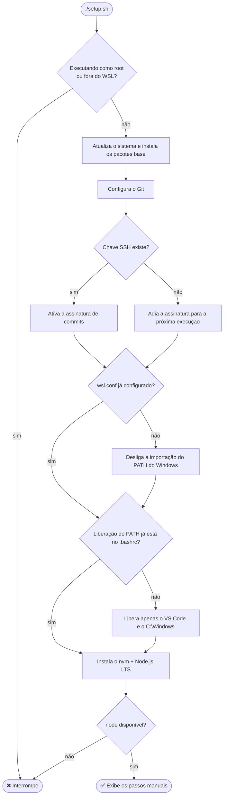

<a name="readme-top"></a>

<picture>
  <source media="(prefers-color-scheme: dark)" srcset="assets/banner-pt-dark.svg">
  <source media="(prefers-color-scheme: light)" srcset="assets/banner-pt-light.svg">
  
</picture>

<div align="center">

[](https://github.com/ADSLustosa/secure-wsl-devkit/actions/workflows/shellcheck.yml)


[](LICENSE)

🌐 [English](README.md) · **Português**

**[Por quê](#-por-que-este-projeto-existe)** · **[Demonstração](#-veja-em-ação)** · **[Impacto](#-impacto-medido)** · **[Como funciona](#-como-funciona)** · **[Segurança](#-decisões-de-segurança)** · **[Como usar](#-como-usar)** · **[Roadmap](#-roadmap)**

</div>

---

## 📌 Por que este projeto existe

Configurar o WSL 2 manualmente em mais de um computador causa três problemas silenciosos:

| Problema | Impacto real |
|---|---|
| **O PATH do Windows vaza para o Linux** | Por padrão, o WSL importa todas as pastas do Windows para o `PATH` do Linux. Comandos como `npm` podem executar, sem aviso, o programa **do Windows** dentro do Linux, causando erros difíceis de diagnosticar e deixando o terminal mais lento. |
| **Os ambientes divergem** | Passos manuais são esquecidos ou feitos de forma diferente em cada máquina, e o código que funciona no notebook quebra no desktop. |
| **Identidade não verificável** | Qualquer pessoa pode fazer commits usando seu nome e e-mail. Sem commits assinados, não há prova de que um commit veio de você. |

O `secure-wsl-devkit` resolve os três com um único script, que pode ser executado com segurança quantas vezes for necessário.

## 🎬 Veja em ação



<sub>Segunda execução em uma máquina já configurada: cada etapa detecta a configuração existente e nada é duplicado.</sub>

## 📊 Impacto medido

<picture>
  <source media="(prefers-color-scheme: dark)" srcset="assets/impact-pt-dark.svg">
  <source media="(prefers-color-scheme: light)" srcset="assets/impact-pt-light.svg">
  
</picture>

> [!NOTE]
> Os números vêm do diagnóstico somente leitura executado na máquina do autor antes e depois do `setup.sh`, e não de estimativas.

## ✨ Destaques

<table>
  <tr>
    <td width="33%" valign="top">🔁 <b>Idempotente</b><br><sub>Rodar duas vezes produz o mesmo resultado que rodar uma. Nada é duplicado.</sub></td>
    <td width="33%" valign="top">🔐 <b>PATH com menor privilégio</b><br><sub>Em vez de importar dezenas de pastas do Windows, apenas <b>2</b> são liberadas explicitamente.</sub></td>
    <td width="33%" valign="top">✍️ <b>Commits assinados</b><br><sub>Cada commit é assinado via SSH e exibe o selo <b>Verified</b> no GitHub.</sub></td>
  </tr>
  <tr>
    <td width="33%" valign="top">🛑 <b>Fail fast</b><br><sub><code>set -euo pipefail</code> interrompe a execução no primeiro erro inesperado.</sub></td>
    <td width="33%" valign="top">🧪 <b>Verificação explícita</b><br><sub>O script confere os resultados em vez de confiar apenas na ausência de erros.</sub></td>
    <td width="33%" valign="top">🤖 <b>Branch main protegida</b><br><sub>Mudanças só entram por pull request, com commits assinados e o ShellCheck verde.</sub></td>
  </tr>
</table>

## 🔄 Como funciona



Cada **losango** é uma verificação de idempotência: a etapa só é executada quando a configuração ainda não existe.

<details>
<summary><b>🧰 O que é configurado</b> (clique para expandir)</summary>
<br>

| Etapa | O que faz | Por quê |
|---|---|---|
| Verificação do ambiente | Bloqueia a execução como `root` e fora do WSL | Evita configurar o usuário ou o sistema errado |
| Pacotes base | `build-essential`, `curl`, `unzip`, `keychain`, `shellcheck` | Compiladores para módulos nativos do Node, agente SSH e análise de scripts |
| Git | Identidade, `main` como branch padrão, `pull.rebase`, `autocrlf input`, `fetch.prune` | Histórico linear, quebras de linha no padrão Linux e lista de branches sempre limpa |
| Assinatura de commits | `gpg.format ssh`, chave de assinatura e `allowed_signers` | Prova criptográfica de autoria |
| `wsl.conf` | `appendWindowsPath = false` | Impede que o PATH do Windows vaze para o Linux |
| Liberação do PATH | Apenas o VS Code e o `C:\Windows` | Mantém o `code .` e o `explorer.exe .` funcionando, e nada além disso |
| Node.js | `nvm` + versão LTS mais recente | Versões de Node por projeto, sem `sudo` |

</details>

## 🔐 Decisões de segurança

| Decisão | Justificativa |
|---|---|
| **A geração da chave SSH é manual, de propósito** | Cada máquina tem sua própria chave. Se um dispositivo for perdido, apenas aquela chave é revogada. Chaves privadas nunca são copiadas nem automatizadas. |
| **A fingerprint do GitHub é conferida manualmente** | Aceitar uma fingerprint desconhecida sem conferir abre caminho para ataques *man-in-the-middle*. |
| **E-mail `noreply` nos commits** | Os commits continuam vinculados à conta do GitHub sem expor um e-mail pessoal a robôs de coleta. |
| **Versão fixa do instalador do nvm** | A URL aponta para uma versão específica, e não para a "mais recente", que poderia mudar sem aviso. |
| **`curl -fsSL`** | O `-f` faz erros HTTP falharem, então uma página de erro nunca é executada pelo `bash`. |
| **Variáveis com prefixo (`DEVKIT_`)** | Evita colisões com variáveis de scripts carregados via `source`, como o `nvm.sh`. |
| **Token do CI somente leitura** | O workflow declara `permissions: contents: read`, seguindo o princípio do menor privilégio. |
| **Branch `main` protegida** | Um ruleset bloqueia pushes diretos, force pushes e commits sem assinatura, e exige o CI verde antes do merge. |
| **Nenhum segredo no repositório** | Senhas, *passphrases* e tokens ficam em um gerenciador de senhas, nunca no código. |

## 🚀 Como usar

**Requisitos:** Windows 10/11 com **WSL 2**, uma distribuição **Ubuntu** (testado no 26.04 LTS) e o **VS Code** instalado no Windows.

### 1. Clonar e executar

Em uma máquina nova ainda não existe chave SSH, então clone via **HTTPS**:

```bash
mkdir -p ~/projetos && cd ~/projetos
git clone https://github.com/ADSLustosa/secure-wsl-devkit.git
cd secure-wsl-devkit
./setup.sh
```

> [!WARNING]
> Não execute com `sudo`. O script pede a senha apenas quando precisa, e executá-lo como `root` configuraria o usuário errado.

### 2. Passos manuais (intencionais)

> [!IMPORTANT]
> Estes passos são manuais **por design**: chaves privadas e decisões de confiança nunca devem ser automatizadas.

```bash
# Gera uma chave exclusiva desta máquina
ssh-keygen -t ed25519 -C "$(hostname)-wsl" -f ~/.ssh/id_ed25519

# Exibe a chave pública para cadastrar no GitHub
cat ~/.ssh/id_ed25519.pub
```

1. No GitHub, acesse **Settings → SSH and GPG keys** e cadastre a chave **duas vezes**: como *Authentication Key* e como *Signing Key*.
2. Rode `ssh -T git@github.com` e compare a fingerprint com as [fingerprints oficiais do GitHub](https://docs.github.com/en/authentication/keeping-your-account-and-data-secure/githubs-ssh-key-fingerprints).
3. Execute `./setup.sh` novamente para ativar a assinatura de commits.
4. No **PowerShell**, reinicie apenas esta distribuição para aplicar o `wsl.conf`: `wsl --terminate Ubuntu-26.04`

> [!TIP]
> Quando o SSH perguntar se você confia no servidor, cole a fingerprint oficial como resposta em vez de digitar `yes`. O SSH compara os valores por você e elimina o erro humano.

<details>
<summary><b>✅ Verificando o resultado</b> (clique para expandir)</summary>
<br>

```bash
# Apenas o VS Code e o C:\Windows devem vir de /mnt/c
echo "$PATH" | tr ':' '\n' | grep '^/mnt/'

# node e npm devem vir de ~/.nvm, nunca de /mnt/c
command -v node npm

# Idempotência: ambos devem exibir 1, mesmo após várias execuções
grep -c "appendWindowsPath" /etc/wsl.conf
grep -c "Caminhos do Windows liberados" ~/.bashrc

# Verificação da assinatura do último commit de qualquer repositório
git log --show-signature -1
```

</details>

<details>
<summary><b>🎨 Sobre os visuais</b> (clique para expandir)</summary>
<br>

Todas as imagens deste README são SVGs animados **gerados por código** pelo [`assets/generate.py`](assets/generate.py), usando apenas a biblioteca padrão do Python:

- **Sem serviços externos ou rastreadores:** nada é carregado de servidores de terceiros.
- **Temas claro e escuro:** o `<picture>` entrega a versão que combina com o tema do GitHub de quem está lendo.
- **Acessível:** cada SVG tem `<title>` e `<desc>` para leitores de tela, e quem ativa a opção de *reduzir movimento* vê o quadro final completo e estático.

Para gerá-las novamente após uma alteração:

```bash
python3 assets/generate.py
```

</details>

## 📁 Estrutura do projeto

```
secure-wsl-devkit/
├── .github/
│   └── workflows/
│       └── shellcheck.yml   # CI: análise estática a cada push e pull request
├── assets/
│   ├── generate.py          # Gera todos os visuais do README (só biblioteca padrão)
│   └── *.svg                # Banner, demonstração do terminal e cards de impacto animados
├── setup.sh                 # Script de setup idempotente
├── LICENSE
├── README.md                # English
└── README.pt-BR.md          # Português
```

## 🧭 Roadmap

- ✅ Script de setup idempotente
- ✅ Commits assinados via SSH
- ✅ Liberação seletiva do PATH do Windows
- ✅ ShellCheck no CI e branch `main` protegida
- ✅ Visuais do README animados, acessíveis e gerados por código
- 🔜 Validar o script em uma distribuição zerada no CI
- 🔜 Configuração do runtime de contêineres (integração do Docker Desktop com o WSL)
- 🔜 Varredura de segredos antes de cada commit com Gitleaks + pre-commit
- 🔜 Fixar as GitHub Actions pelo SHA do commit, com atualizações via Dependabot

## 📄 Licença

Distribuído sob a licença MIT. Consulte o arquivo [LICENSE](LICENSE) para mais detalhes.

---

<div align="center">

Desenvolvido por **[ADSLustosa](https://github.com/ADSLustosa)** · Desenvolvedor full-stack com foco em segurança e proteção de dados (LGPD)

<sub>[↑ Voltar ao topo](#readme-top)</sub>

</div>
